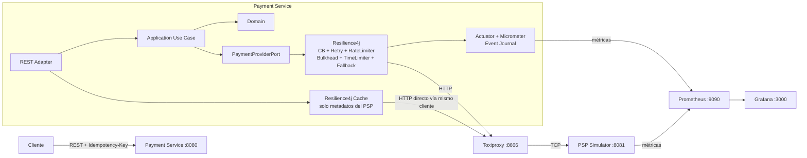

# Resilience4j - Payment Processing

PoC de resiliencia sobre un flujo de autorización de pagos. No es un ejemplo de `@CircuitBreaker` aislado.
la idea es poder provocar fallas HTTP y de red, comparar órdenes de composición, saturar recursos, observar métricas y validar cómo se 
recupera el servicio.

El servicio principal es un microservicio REST con DDD + arquitectura hexagonal. El PSP externo está simulado en un segundo módulo 
para poder controlar sus fallas. Toxiproxy queda entre ambos cuando quiero introducir problemas de red reales.

## Capacidades


| Capacidad | Qué pruebo en la PoC |
| --- | --- |
| Circuit Breaker | Estados `CLOSED`, `OPEN`, `HALF_OPEN`, `FORCED_OPEN`, `METRICS_ONLY` y `DISABLED`, failure rate y slow-call rate |
| Retry | Reintentos selectivos para fallas temporales con exponential backoff + jitter |
| Rate Limiter | Protección de la cuota del PSP, compartida por todas las modalidades, y rechazo rápido cuando se agotan permisos |
| Semaphore Bulkhead | Límite de concurrencia sin crear otro pool de threads |
| ThreadPool Bulkhead | Aislamiento con pool y cola propios para comparar el modelo de ejecución |
| Time Limiter | Presupuesto máximo de tiempo para la operación hacia el PSP |
| Fallback | Respuesta degradada segura: nunca invento una autorización y distingo "no procesado" de "resultado desconocido" |
| Cache | Cacheo metadatos del proveedor, no autorizaciones de pago |
| Decorators | Composición programática para cambiar el orden de los patrones |
| Annotations/AOP | Alternativa declarativa para comparar con la composición programática |
| Event Publisher | Journal en memoria con los eventos emitidos por cada componente de resiliencia |
| Micrometer | Métricas técnicas de Resilience4j y del PSP simulado |
| Prometheus + Grafana | Scraping y dashboard listo para observar los experimentos |
| Toxiproxy | Latencia, timeout, TCP reset y caída total del enlace |
| Virtual Threads | El servicio usa virtual threads para trabajo bloqueante y el scheduler de timeouts queda separado |
| Idempotencia | Todos los retries reutilizan el mismo `Idempotency-Key`; el PSP no crea dos autorizaciones para la misma clave y rechaza la clave reutilizada con otros datos |


## 2. Stack y versiones

El proyecto está fijado a versiones actuales y compatibles con el objetivo de Java 25:

| Tecnología | Versión usada |
| --- | --- |
| Java | 25 |
| Maven | 3.9.x (3.9.16 recomendado y usado en CI) |
| Spring Boot | 4.1.1 |
| Spring Framework | 7.0.9, administrado por Spring Boot 4.1.1 |
| Resilience4j | 2.4.0 |
| Resilience4j Spring Boot | `resilience4j-spring-boot4` 2.4.0 |
| Caffeine JCache | 3.3.0 |
| Prometheus | 3.15.0 |
| Grafana | 13.2.2 |
| Toxiproxy | 2.12.0 |

El `pom.xml` raíz usa Maven Enforcer para exigir Java 25 y Maven 3.9.x. No fijo el patch local de Maven porque Spring Boot 4.1.1 
soporta Maven 3.6.3 o superior y los plugins Maven actuales mantienen compatibilidad con Maven 3.9.x. Para tener un build reproducible, el script de verificación y el CI sí usan Maven 3.9.16. Resilience4j se versiona explícitamente porque la integración usada es la específica para Spring Boot 4.

## 3. Caso de uso funcional

El cliente solicita una autorización de pago. `payment-service` crea el agregado de pago y llama al PSP externo usando una clave 
de idempotencia proporcionada por el cliente.

El PSP puede estar saludable, lento, responder 429/503, fallar algunas veces o quedar inaccesible. La PoC aplica las políticas de 
resiliencia y devuelve:

- `200 AUTHORIZED` únicamente cuando existe confirmación del PSP.
- `422 REJECTED` cuando el PSP rechaza la operación por negocio (4xx). Es una respuesta válida del proveedor: no se reintenta ni pasa por el fallback.
- `409 IDEMPOTENCY_CONFLICT` cuando la `Idempotency-Key` ya se usó con otro comercio, importe o moneda.
- `503 NOT_PROCESSED` cuando el fallback se activa y existe certeza de que el PSP no procesó el pago: Circuit Breaker abierto, Bulkhead lleno, cuota agotada, conexión rechazada o errores 429/5xx explícitos del PSP.
- `202 UNKNOWN` cuando el fallback se activa pero la llamada pudo llegar al PSP: el TimeLimiter venció con un intento en vuelo o la conexión se cortó después de enviar el request. El PSP puede autorizar después de que el cliente recibió la respuesta, así que el sistema no afirma ni niega el cobro. El estado final se obtiene reenviando el mismo request con la misma `Idempotency-Key`.

La idempotencia es parte central del ejemplo: un retry no genera un nuevo intento lógico de cobro. Todas las llamadas físicas del 
mismo request conservan el mismo `Idempotency-Key`, y el `paymentId` se deriva de esa clave para que un reintento del cliente apunte al mismo pago lógico.

## 4. Arquitectura



`payment-service` apunta por defecto a `http://localhost:8666`, que es el puerto expuesto por Toxiproxy. 
Toxiproxy reenvía al PSP que corre en el host por `8081`.

## 5. DDD y arquitectura hexagonal

El dominio se mantiene independiente de Spring y Resilience4j:

```text
payment-service
└── pe.axiz.payment
    ├── domain
    │   └── model
    │       ├── Money
    │       ├── Payment
    │       ├── PaymentResult
    │       └── PaymentStatus
    ├── application
    │   ├── port
    │   │   ├── in
    │   │   └── out
    │   └── service
    ├── adapter
    │   ├── in/rest
    │   └── out/psp
    ├── cache
    ├── config
    └── resilience
```

`ProcessPaymentUseCase` es el puerto de entrada. `PaymentProviderPort` es el puerto de salida. Las dos implementaciones del 
puerto son `ProgrammaticPspAdapter` y `DeclarativePspAdapter`; el dominio no sabe que existe Resilience4j ni HTTP.

## 6. Estructura del repositorio

```text
resilience4j-payment-poc/
├── README.md                         documentación única del repositorio
├── pom.xml                           agregador Maven y validación de Java/Maven
├── payment-service/                  microservicio de autorización de pagos
├── psp-simulator/                    PSP controlable para generar fallas
├── datasets/                         escenarios y pagos de prueba
├── infrastructure/                   Docker Compose, observabilidad y Toxiproxy
│   ├── docker-compose.yml
│   ├── prometheus/
│   ├── grafana/
│   ├── toxiproxy/
│   ├── requests/                     requests HTTP y JSON de request/response
│   └── scripts/                      inyección de fallas de red
├── scripts/                          utilidades del proyecto
└── .github/workflows/ci.yml          build reproducible con Temurin 25
```

## 7. Código principal

### 7.1 `ProgrammaticPspAdapter`

Es el núcleo técnico de la PoC. Construye los decorators en código y permite cambiar dos dimensiones desde el request:

- `composition=PER_ATTEMPT`: el Circuit Breaker queda dentro de Retry y registra cada intento físico.
- `composition=PER_REQUEST`: Retry queda dentro del Circuit Breaker y este registra el resultado del request lógico.
- `isolation=SEMAPHORE`: usa `Bulkhead` por semáforo.
- `isolation=THREAD_POOL`: usa `ThreadPoolBulkhead` con pool y cola propios.

La diferencia de composición es intencional:

```text
PER_ATTEMPT
Fallback(TimeLimiter(Retry(CircuitBreaker(Bulkhead(RateLimiter(PSP))))))

PER_REQUEST
Fallback(TimeLimiter(CircuitBreaker(Retry(Bulkhead(RateLimiter(PSP))))))
```

En ambos casos el Rate Limiter está dentro de Retry para que cada intento físico consuma permiso del proveedor. Eso evita que 
un request con tres retries se contabilice falsamente como un solo uso de cuota.

El orden es el mismo con `isolation=SEMAPHORE` y con `isolation=THREAD_POOL`; solo cambia la implementación del eslabón `Bulkhead`. 
Con `ThreadPoolBulkhead` cada intento físico toma un hilo del pool y lo libera al terminar, así que la espera del backoff no ocupa hilos del pool.

Cada request lógico crea un `PspInvocation` que comparten todos sus intentos físicos. Cumple dos funciones:

- lleva la cuenta de los intentos en vuelo y de los cortes de red ambiguos, para que el fallback decida entre `NOT_PROCESSED` y `UNKNOWN`;
- aplica un deadline igual al presupuesto del TimeLimiter. Cuando el TimeLimiter ya respondió al cliente, Retry todavía puede programar reintentos en segundo plano; esos intentos huérfanos se descartan antes de salir al PSP con `PspDeadlineExceededException`, que Retry y Circuit Breaker ignoran.

### 7.2 `DeclarativeProtectedPspCall` y `DeclarativeTimedPspCall`

Muestran el equivalente con anotaciones `@Retry`, `@CircuitBreaker`, `@RateLimiter`, `@Bulkhead` y `@TimeLimiter`.

`TimeLimiter` está en otro bean a propósito. Así la llamada pasa por el proxy AOP de Spring y evito el problema clásico de self-invocation.

Con el orden de aspectos por defecto de Resilience4j, la cadena declarativa queda así:

```text
Fallback(TimeLimiter(Retry(CircuitBreaker(RateLimiter(Bulkhead(PSP))))))
```

Es decir, el Circuit Breaker declarativo registra cada intento físico, como `PER_ATTEMPT`. El fallback recibe el mismo `PspInvocation` que los intentos, así que aplica las mismas reglas de `NOT_PROCESSED`/`UNKNOWN` y el mismo deadline.

### 7.3 `PspHttpClient`

Usa `RestClient` de Spring Framework 7 y el HTTP Client del JDK. Tiene connect/read timeout y clasifica errores:

- HTTP `429` y `5xx`: `PspTemporaryException`, elegibles para Retry y Circuit Breaker.
- errores de red: `PspNetworkException`, elegibles para Retry y Circuit Breaker. Además indica si el request pudo llegar al PSP: una conexión rechazada, un timeout de conexión o un host desconocido significan que nunca salió; un reset o un corte a mitad de la respuesta dejan el resultado en duda.
- otros `4xx`: `PspBusinessException`, con el status HTTP. Los adaptadores la convierten en un resultado `REJECTED` (o `IDEMPOTENCY_CONFLICT` para `409`), por lo que no se reintenta, cuenta como llamada exitosa en el Circuit Breaker y nunca llega al fallback.

### 7.4 `PspSimulatorService`

Permite cargar escenarios sin reiniciar el servicio. Los escenarios deterministas (`fail-first-two`, `unstable-every-two`, `unavailable`) son los que uso para pruebas repetibles. También existe `random-40` para experimentar con un patrón no determinista, y `declined` para producir un rechazo de negocio (`402`).

La idempotencia se implementa en memoria por `Idempotency-Key`. Si una autorización ya fue creada y la nueva llamada trae el mismo comercio, importe y moneda, devuelve la misma referencia y `replayed=true`. Si la clave llega con otros datos responde `409 IDEMPOTENCY_CONFLICT`: devolver la autorización previa haría creer al cliente que se autorizó un importe que nunca se cobró.

### 7.5 `ProviderCapabilitiesCacheService`

Demuestra `resilience4j-cache` con JCache/Caffeine. Cachea durante 30 segundos las capacidades del PSP. No cacheo el resultado de una autorización de pago: para eso uso idempotencia, porque cachear el resultado de una operación monetaria puede ocultar el estado real de una transacción.

### 7.6 `ResilienceEventJournal`

Mantiene los últimos 500 eventos emitidos por Circuit Breaker, Retry, Rate Limiter, Bulkhead, ThreadPoolBulkhead y TimeLimiter. Sirve para inspeccionar la secuencia exacta de un experimento sin depender del log.

## 8. Configuración de resiliencia

La configuración está en `payment-service/src/main/resources/application.yml`.

### Circuit Breaker

- ventana: 10 llamadas, count-based.
- mínimo: 5 llamadas.
- failure rate: 50%.
- slow-call rate: 50%.
- slow call: más de 800 ms.
- `OPEN`: 5 s.
- `HALF_OPEN`: 3 llamadas de prueba.
- transición automática a `HALF_OPEN`.

### Retry

- máximo 3 intentos.
- espera inicial 200 ms.
- exponential backoff x2.
- máximo 2 s.
- jitter 50%.
- solo reintenta errores temporales/de red.

### Rate Limiter

- una sola instancia, `pspProvider`, compartida por las variantes programáticas y la declarativa: la cuota pertenece al proveedor, no a la modalidad.
- 10 permisos por segundo en total contra el PSP.
- espera máxima por permiso: 100 ms.

Circuit Breaker, Retry, Bulkhead y TimeLimiter siguen teniendo una instancia por modalidad para poder comparar sus métricas por separado.

### Semaphore Bulkhead

- 4 ejecuciones concurrentes.
- sin cola de espera: cuando no hay permiso falla rápido.

### ThreadPool Bulkhead

- 2 threads core.
- 4 threads máximo.
- cola de 4.

### Time Limiter

- 1500 ms por operación lógica.

Estos valores son chicos a propósito para que los cambios de estado se puedan ver rápido en una laptop. En producción tendrían que salir de SLOs, latencias reales, capacidad del proveedor y pruebas de carga.

## 9. Endpoints

Los ordeno como normalmente los uso al ejecutar la PoC.

| Orden | Método y endpoint | Funcional | Técnico |
| ---: | --- | --- | --- |
| 1 | `POST :8081/admin/scenarios/import` | Carga escenarios del PSP | Inicializa el dataset de fallas |
| 2 | `POST :8081/admin/reset` | Limpia autorizaciones del simulador | Reinicia contadores para una prueba repetible |
| 3 | `POST :8081/admin/scenarios/{name}/activate` | Cambia el comportamiento del PSP | Inyecta 429/503, latencia o fallas deterministas |
| 4 | `GET :8081/admin/scenarios` | Lista escenarios | Confirma cuál está activo |
| 5 | `POST :8080/api/v1/payments/programmatic` | Autoriza un pago | Ejecuta decorators y permite elegir composición/aislamiento |
| 6 | `POST :8080/api/v1/payments/declarative` | Autoriza un pago | Ejecuta annotations/AOP |
| 7 | `GET :8080/internal/resilience/snapshot` | No tiene uso funcional | Snapshot de métricas internas de los componentes |
| 8 | `GET :8080/internal/resilience/events` | No tiene uso funcional | Muestra la secuencia de eventos Resilience4j |
| 9 | `DELETE :8080/internal/resilience/events` | No tiene uso funcional | Limpia el journal antes de un experimento |
| 10 | `POST :8080/internal/resilience/circuit-breakers/{name}/reset` | No tiene uso funcional | Lleva el CB al estado normal inicial |
| 11 | `POST :8080/internal/resilience/circuit-breakers/{name}/force-open` | No tiene uso funcional | Prueba `FORCED_OPEN` |
| 12 | `POST :8080/internal/resilience/circuit-breakers/{name}/metrics-only` | No tiene uso funcional | Prueba `METRICS_ONLY` |
| 13 | `POST :8080/internal/resilience/circuit-breakers/{name}/disable` | No tiene uso funcional | Prueba `DISABLED` |
| 14 | `GET :8080/api/v1/payments/provider-capabilities` | Consulta capacidades del PSP | Demuestra Resilience4j Cache |
| 15 | `GET :8080/api/v1/payments/provider-capabilities/cache-metrics` | No tiene uso funcional | Muestra hit/miss del cache |
| 16 | `GET :8081/admin/stats` | Estado del simulador | Confirma llamadas, fallas, replays y autorizaciones reales |
| 17 | `GET :8081/admin/authorizations` | Lista autorizaciones | Permite comprobar que Retry no generó doble cobro |
| 18 | `GET :8080/actuator/prometheus` | No tiene uso funcional | Métricas para Prometheus |

Los nombres válidos para administrar Circuit Breaker son:

```text
pspProgrammaticAttempt
pspProgrammaticRequest
pspDeclarative
```

## 10. Request y response principal

Request:

```http
POST /api/v1/payments/programmatic?composition=PER_REQUEST&isolation=SEMAPHORE
Idempotency-Key: payment-001
Content-Type: application/json
```

```json
{
  "merchantId": "merchant-demo",
  "amount": 149.90,
  "currency": "PEN"
}
```

Autorizado:

```json
{
  "paymentId": "11111111-2222-3333-4444-555555555555",
  "status": "AUTHORIZED",
  "providerReference": "auth-aaaaaaaa-bbbb-cccc-dddd-eeeeeeeeeeee",
  "replayed": false,
  "detail": "Pago autorizado por el PSP"
}
```

Fallback seguro con certeza de que el PSP no procesó el pago (`503`):

```json
{
  "paymentId": "11111111-2222-3333-4444-555555555555",
  "status": "NOT_PROCESSED",
  "providerReference": null,
  "replayed": false,
  "detail": "El pago no fue procesado. La protección de resiliencia terminó la llamada por CallNotPermittedException"
}
```

Fallback con resultado desconocido (`202`), por ejemplo tras un timeout con un intento en vuelo:

```json
{
  "paymentId": "11111111-2222-3333-4444-555555555555",
  "status": "UNKNOWN",
  "providerReference": null,
  "replayed": false,
  "detail": "Resultado desconocido: la llamada al PSP pudo completarse después de TimeoutException. Reintente con la misma Idempotency-Key para conocer el estado final"
}
```

También dejé requests para IntelliJ/VS Code en `infrastructure/requests/` y ejemplos JSON en `infrastructure/requests/examples/`.

## 11. Requisitos

```text
JDK 25
Maven 3.9.x; recomiendo 3.9.16, pero 3.9.0 o superior dentro de la rama 3.9.x es aceptado por el proyecto
Docker con Docker Compose v2
curl
```

Los puertos usados son:

```text
8080 payment-service
8081 psp-simulator
8666 Toxiproxy -> PSP
8474 Toxiproxy API
9090 Prometheus
3000 Grafana
```

## 12. Levantar infraestructura

Desde la raíz:

```bash
cd infrastructure
docker compose up
```
La infraestructura levanta solamente:

```text
Toxiproxy
Prometheus
Grafana
```

Prometheus apunta a los servicios que se ejecutan desde el IDE en el host.

Grafana queda en `http://localhost:3000` con usuario `admin` y password `admin`. El datasource y el dashboard `Axiz - Payment Resilience` se provisionan automáticamente. Se deshabilita la preinstalación automática de plugins porque esta PoC solo necesita las capacidades incluidas para consultar Prometheus; también existen directorios vacíos de provisioning para `plugins` y `alerting` para evitar errores de arranque innecesarios en el log.

## 13. Ejecutar los servicios

Primero el PSP:

```bash
mvn -pl psp-simulator spring-boot:run
```

Luego el servicio de pagos en otra terminal:

```bash
mvn -pl payment-service spring-boot:run
```

El flujo queda:

```text
payment-service :8080
       |
       v
Toxiproxy :8666
       |
       v
psp-simulator :8081
```

Si quiero saltar Toxiproxy temporalmente:

```bash
PSP_BASE_URL=http://localhost:8081 mvn -pl payment-service spring-boot:run
```

## 14. Cargar datasets

Con ambos servicios arriba:

Linux/macOS/Git Bash:

```bash
./datasets/load.sh
```

PowerShell:

```powershell
./datasets/load.ps1
```

El script:

1. carga `datasets/scenarios.json` en el PSP;
2. activa `healthy`;
3. limpia contadores y autorizaciones previas.

`datasets/payments.jsonl` contiene pagos de ejemplo. Se pueden ejecutar todos con:

```bash
./scripts/run-dataset-payments.sh
```

## 15. Pruebas por curl

Antes de cada bloque conviene dejar el enlace de red limpio:

```bash
./infrastructure/scripts/network-reset.sh
```

### Test 1: camino saludable

Activo PSP saludable:

```bash
curl -X POST http://localhost:8081/admin/scenarios/healthy/activate
```

Autorizo:

```bash
curl -i -X POST \
  'http://localhost:8080/api/v1/payments/programmatic?composition=PER_REQUEST&isolation=SEMAPHORE' \
  -H 'Content-Type: application/json' \
  -H 'Idempotency-Key: healthy-001' \
  -d '{"merchantId":"merchant-demo","amount":149.90,"currency":"PEN"}'
```

Qué estoy comprobando: el request atraviesa RateLimiter, Bulkhead, Retry, Circuit Breaker y TimeLimiter sin activar protección. 
Debe responder `200` y `AUTHORIZED`.

### Test 2: Retry con backoff + idempotencia

Reinicio el simulador y hago que las dos primeras llamadas físicas fallen:

```bash
curl -X POST http://localhost:8081/admin/reset
curl -X POST http://localhost:8081/admin/scenarios/fail-first-two/activate
```

Ejecuto un solo pago:

```bash
curl -i -X POST \
  'http://localhost:8080/api/v1/payments/programmatic?composition=PER_REQUEST&isolation=SEMAPHORE' \
  -H 'Content-Type: application/json' \
  -H 'Idempotency-Key: retry-001' \
  -d '{"merchantId":"merchant-demo","amount":99.90,"currency":"PEN"}'
```

Reviso estadísticas:

```bash
curl http://localhost:8081/admin/stats
curl http://localhost:8081/admin/authorizations
curl http://localhost:8080/internal/resilience/events?limit=50
```

Qué estoy comprobando: deben existir tres llamadas físicas pero una sola autorización. Retry usa la misma clave de idempotencia en todos los intentos.

### Test 3: comparar `PER_ATTEMPT` vs `PER_REQUEST`

Primero limpio ambos breakers y el PSP:

```bash
curl -X POST http://localhost:8080/internal/resilience/circuit-breakers/pspProgrammaticAttempt/reset
curl -X POST http://localhost:8080/internal/resilience/circuit-breakers/pspProgrammaticRequest/reset
curl -X POST http://localhost:8081/admin/reset
curl -X POST http://localhost:8081/admin/scenarios/fail-first-two/activate
```

Con Circuit Breaker por intento:

```bash
curl -X POST \
  'http://localhost:8080/api/v1/payments/programmatic?composition=PER_ATTEMPT&isolation=SEMAPHORE' \
  -H 'Content-Type: application/json' \
  -H 'Idempotency-Key: order-attempt-001' \
  -d '{"merchantId":"merchant-demo","amount":50.00,"currency":"PEN"}'
```

Consulto snapshot:

```bash
curl http://localhost:8080/internal/resilience/snapshot
```

Repito el reset y pruebo `PER_REQUEST`:

```bash
curl -X POST http://localhost:8081/admin/reset
curl -X POST http://localhost:8081/admin/scenarios/fail-first-two/activate
curl -X POST \
  'http://localhost:8080/api/v1/payments/programmatic?composition=PER_REQUEST&isolation=SEMAPHORE' \
  -H 'Content-Type: application/json' \
  -H 'Idempotency-Key: order-request-001' \
  -d '{"merchantId":"merchant-demo","amount":50.00,"currency":"PEN"}'
```

Qué estoy comprobando: `pspProgrammaticAttempt` ve los intentos que fallaron antes del éxito. `pspProgrammaticRequest` ve principalmente el resultado lógico una vez agotado/terminado Retry. Este test es el motivo por el que mantengo una variante programática además de annotations.

### Test 4: abrir Circuit Breaker y observar recuperación

```bash
curl -X POST http://localhost:8081/admin/reset
curl -X POST http://localhost:8080/internal/resilience/circuit-breakers/pspProgrammaticRequest/reset
curl -X POST http://localhost:8081/admin/scenarios/unavailable/activate
```

Genero varias operaciones con claves distintas:

```bash
for i in {1..8}; do
  curl -s -o /dev/null -w "%{http_code}\n" -X POST \
    'http://localhost:8080/api/v1/payments/programmatic?composition=PER_REQUEST&isolation=SEMAPHORE' \
    -H 'Content-Type: application/json' \
    -H "Idempotency-Key: cb-$i" \
    -d '{"merchantId":"merchant-demo","amount":10.00,"currency":"PEN"}'
done
```

```bash
curl http://localhost:8080/internal/resilience/snapshot
```

Prueba: luego del mínimo de llamadas y con failure rate suficiente, el breaker pasa a `OPEN` y empieza a rechazar sin tocar el PSP.

Ahora recupera el PSP:

```bash
curl -X POST http://localhost:8081/admin/scenarios/healthy/activate
```

Espera algo más de 5 segundos y envío tres pagos nuevos. El breaker tiene permiso para probar el backend en `HALF_OPEN`; si las llamadas salen bien vuelve a `CLOSED`.

### Test 5: slow calls y TimeLimiter

```bash
curl -X POST http://localhost:8081/admin/reset
curl -X POST http://localhost:8081/admin/scenarios/slow-2s/activate
```

```bash
curl -i -X POST \
  'http://localhost:8080/api/v1/payments/programmatic?composition=PER_REQUEST&isolation=SEMAPHORE' \
  -H 'Content-Type: application/json' \
  -H 'Idempotency-Key: timeout-001' \
  -d '{"merchantId":"merchant-demo","amount":20.00,"currency":"PEN"}'
```

Prueba: el TimeLimiter está en 1500 ms y el PSP tarda 2 s. El cliente recibe `202 UNKNOWN`: no devuelvo una autorización falsa, pero tampoco afirmo que el pago no se procesó.

Pasados 2 segundos reviso el PSP:

```bash
curl http://localhost:8081/admin/authorizations
```

La autorización `timeout-001` existe: el PSP autorizó después de que el TimeLimiter respondió al cliente. Si hubiera respondido `NOT_PROCESSED`, el cliente podría haber cobrado por otro medio y generado un doble cobro.

Para conocer el estado final reenvío el mismo request con la misma clave:

```bash
curl -i -X POST \
  'http://localhost:8080/api/v1/payments/programmatic?composition=PER_REQUEST&isolation=SEMAPHORE' \
  -H 'Content-Type: application/json' \
  -H 'Idempotency-Key: timeout-001' \
  -d '{"merchantId":"merchant-demo","amount":20.00,"currency":"PEN"}'
```

La respuesta es `200 AUTHORIZED` con `replayed=true` y el mismo `paymentId`. El PSP responde el replay sin aplicar la latencia del escenario.

Para revisar eventos:

```bash
curl http://localhost:8080/internal/resilience/events?limit=100
```

### Test 6: Rate Limiter

Dejo el PSP saludable y mando un burst. Cada intento físico consume permiso:

```bash
curl -X POST http://localhost:8081/admin/scenarios/healthy/activate
seq 1 25 | xargs -P 25 -I {} curl -s -o /dev/null -w '%{http_code}\n' \
  -X POST \
  'http://localhost:8080/api/v1/payments/programmatic?composition=PER_REQUEST&isolation=SEMAPHORE' \
  -H 'Content-Type: application/json' \
  -H 'Idempotency-Key: rate-{}' \
  -d '{"merchantId":"merchant-demo","amount":10.00,"currency":"PEN"}'
```

Prueba: con 10 permisos/segundo y 100 ms de espera, parte del burst debe ser rechazado/protegido en lugar de dejar crecer una cola sin límite. La cuota es la misma para todas las modalidades: si durante el burst también llegan pagos por `PER_ATTEMPT` o por el endpoint declarativo, consumen de `pspProvider` (`providerRateLimiter` en el snapshot).

### Test 7: Semaphore Bulkhead

Uso un PSP lento pero por debajo del read timeout y envío concurrencia:

```bash
curl -X POST http://localhost:8081/admin/scenarios/slow-2s/activate
seq 1 12 | xargs -P 12 -I {} curl -s -o /dev/null -w '%{http_code}\n' \
  -X POST \
  'http://localhost:8080/api/v1/payments/programmatic?composition=PER_REQUEST&isolation=SEMAPHORE' \
  -H 'Content-Type: application/json' \
  -H 'Idempotency-Key: semaphore-{}' \
  -d '{"merchantId":"merchant-demo","amount":10.00,"currency":"PEN"}'
```

Prueba: solo 4 ejecuciones pueden ocupar el segmento protegido a la vez. El resto falla rápido por `BulkheadFullException` y termina en `503 NOT_PROCESSED`, porque nunca salió al PSP. Las 4 que entraron vencen el TimeLimiter con la llamada en vuelo y responden `202 UNKNOWN`.

### Test 8: ThreadPool Bulkhead

```bash
seq 1 12 | xargs -P 12 -I {} curl -s -o /dev/null -w '%{http_code}\n' \
  -X POST \
  'http://localhost:8080/api/v1/payments/programmatic?composition=PER_REQUEST&isolation=THREAD_POOL' \
  -H 'Content-Type: application/json' \
  -H 'Idempotency-Key: threadpool-{}' \
  -d '{"merchantId":"merchant-demo","amount":10.00,"currency":"PEN"}'
```

```bash
curl http://localhost:8080/internal/resilience/snapshot
```

Qué estoy comprobando: el aislamiento ahora tiene pool de 2-4 threads y cola de 4. El snapshot permite ver tamaño del pool y profundidad/capacidad de la cola.

Con `slow-2s` todavía activo desde el test anterior, el reparto esperado es:

- 4 requests ocupan los threads y vencen el TimeLimiter en vuelo: `202 UNKNOWN`;
- 4 quedan en la cola y el TimeLimiter vence antes de que empiecen: `503 NOT_PROCESSED`. Cuando obtienen un thread, el deadline ya venció y se descartan sin llamar al PSP;
- 4 no entran ni en la cola: `503 NOT_PROCESSED` por `BulkheadFullException`.

`GET :8081/admin/stats` muestra solo 4 llamadas nuevas en el PSP.

### Test 9: falla HTTP 429

```bash
curl -X POST http://localhost:8081/admin/reset
curl -X POST http://localhost:8081/admin/scenarios/rate-limited/activate
curl -i -X POST \
  'http://localhost:8080/api/v1/payments/programmatic?composition=PER_REQUEST&isolation=SEMAPHORE' \
  -H 'Content-Type: application/json' \
  -H 'Idempotency-Key: psp-429-001' \
  -d '{"merchantId":"merchant-demo","amount":10.00,"currency":"PEN"}'
```

Prueba: 429 se considera temporal, participa de Retry y del Circuit Breaker.

### Test 10: latencia real de red con Toxiproxy

Primero PSP saludable:

```bash
curl -X POST http://localhost:8081/admin/scenarios/healthy/activate
./infrastructure/scripts/network-latency.sh 1200 100
```

Se ejecuta un pago y revisa eventos/métricas. La latencia no está dentro del PSP: Toxiproxy la agrega en el trayecto TCP.

Limpio:

```bash
./infrastructure/scripts/network-reset.sh
```

### Test 11: timeout de red

```bash
./infrastructure/scripts/network-timeout.sh 4000
```

Se ejecuta un pago normal. El TimeLimiter debe terminar antes de que el enlace entregue la respuesta. El resultado es `202 UNKNOWN`: desde el cliente no hay forma de saber si el request llegó al PSP.

```bash
./infrastructure/scripts/network-reset.sh
```

### Test 12: TCP reset

```bash
./infrastructure/scripts/network-reset-peer.sh 0
```

Se ejecuta un pago y verifico que el error de transporte se clasifica como falla de red y es elegible para Retry. Como la conexión se establece y se corta después, el resultado final es `202 UNKNOWN`.

```bash
./infrastructure/scripts/network-reset.sh
```

### Test 13: caída total del enlace

```bash
./infrastructure/scripts/network-down.sh
```

Se hace varios pagos con claves diferentes y observo Retry + Circuit Breaker. Aquí la conexión se rechaza, así que hay certeza de que el request no salió y la respuesta es `503 NOT_PROCESSED`. Luego recupero el proxy:

```bash
./infrastructure/scripts/network-up.sh
./infrastructure/scripts/network-reset.sh
```

### Test 14: estados especiales del Circuit Breaker

Fuerzo apertura:

```bash
curl -X POST http://localhost:8080/internal/resilience/circuit-breakers/pspProgrammaticRequest/force-open
```

El siguiente request se corta aunque el PSP esté saludable.

Modo solo métricas:

```bash
curl -X POST http://localhost:8080/internal/resilience/circuit-breakers/pspProgrammaticRequest/metrics-only
```

Registra métricas pero no abre por threshold.

Deshabilitado:

```bash
curl -X POST http://localhost:8080/internal/resilience/circuit-breakers/pspProgrammaticRequest/disable
```

Para volver al flujo normal:

```bash
curl -X POST http://localhost:8080/internal/resilience/circuit-breakers/pspProgrammaticRequest/reset
```

### Test 15: implementación declarativa

```bash
curl -X POST http://localhost:8081/admin/reset
curl -X POST http://localhost:8081/admin/scenarios/fail-first-two/activate
curl -i -X POST \
  http://localhost:8080/api/v1/payments/declarative \
  -H 'Content-Type: application/json' \
  -H 'Idempotency-Key: declarative-001' \
  -d '{"merchantId":"merchant-demo","amount":30.00,"currency":"PEN"}'
```

Prueba: el mismo problema se resuelve con annotations/AOP. Para experimentar con órdenes arbitrarios prefiero el endpoint programático porque el chain queda explícito en código.

### Test 16: Cache de capacidades del PSP

Primera consulta:

```bash
curl http://localhost:8080/api/v1/payments/provider-capabilities
curl http://localhost:8080/api/v1/payments/provider-capabilities/cache-metrics
```

Segunda consulta antes de 30 segundos:

```bash
curl http://localhost:8080/api/v1/payments/provider-capabilities
curl http://localhost:8080/api/v1/payments/provider-capabilities/cache-metrics
```

Prueba: la primera llamada es miss y consulta el PSP; la segunda reutiliza el valor. El campo `generatedAt` permite ver que la respuesta es la misma. Este patrón está limitado a metadata que tolera staleness.

### Test 17: rechazo de negocio

```bash
curl -X POST http://localhost:8081/admin/reset
curl -X POST http://localhost:8080/internal/resilience/circuit-breakers/pspProgrammaticRequest/reset
curl -X POST http://localhost:8081/admin/scenarios/declined/activate
curl -i -X POST \
  'http://localhost:8080/api/v1/payments/programmatic?composition=PER_REQUEST&isolation=SEMAPHORE' \
  -H 'Content-Type: application/json' \
  -H 'Idempotency-Key: declined-001' \
  -d '{"merchantId":"merchant-demo","amount":10.00,"currency":"PEN"}'
curl http://localhost:8081/admin/stats
curl http://localhost:8080/internal/resilience/snapshot
```

Prueba: el PSP responde `402` y el cliente recibe `422 REJECTED`, no `503`. Hay una sola llamada física porque un rechazo de negocio no se reintenta, y el Circuit Breaker no registra fallas: el PSP está sano, solo rechazó el pago.

### Test 18: misma clave con otros datos

```bash
curl -X POST http://localhost:8081/admin/reset
curl -X POST http://localhost:8081/admin/scenarios/healthy/activate
curl -i -X POST \
  'http://localhost:8080/api/v1/payments/programmatic?composition=PER_REQUEST&isolation=SEMAPHORE' \
  -H 'Content-Type: application/json' \
  -H 'Idempotency-Key: reuse-001' \
  -d '{"merchantId":"merchant-demo","amount":10.00,"currency":"PEN"}'
curl -i -X POST \
  'http://localhost:8080/api/v1/payments/programmatic?composition=PER_REQUEST&isolation=SEMAPHORE' \
  -H 'Content-Type: application/json' \
  -H 'Idempotency-Key: reuse-001' \
  -d '{"merchantId":"merchant-demo","amount":500.00,"currency":"PEN"}'
curl http://localhost:8081/admin/authorizations
```

Prueba: el primer request autoriza 10.00. El segundo reutiliza la clave con 500.00 y recibe `409 IDEMPOTENCY_CONFLICT` en lugar de la autorización de 10.00. Ambos responden el mismo `paymentId` porque se deriva de la clave. Un reenvío idéntico al primero sí devuelve `200 AUTHORIZED` con `replayed=true`.

## 16. Observabilidad

Prometheus:

```text
http://localhost:9090
```

Grafana:

```text
http://localhost:3000
admin / admin
```

Dashboard provisionado:

```text
Axiz / Axiz - Payment Resilience
```

Algunas métricas útiles:

```text
resilience4j_circuitbreaker_state
resilience4j_circuitbreaker_failure_rate
resilience4j_circuitbreaker_slow_call_rate
resilience4j_retry_calls
resilience4j_ratelimiter_available_permissions
resilience4j_bulkhead_available_concurrent_calls
resilience4j_timelimiter_calls_total
psp_simulator_requests_total
```

Además del dashboard, para una inspección rápida uso:

```bash
curl http://localhost:8080/internal/resilience/snapshot
curl http://localhost:8080/internal/resilience/events?limit=100
```

### 16.1 Qué valida cada panel de Grafana

El dashboard se refresca cada 5 segundos. Tiene siete paneles y cada uno sirve para confirmar visualmente el resultado de uno o varios tests de la sección 15:

| Panel | Métrica | Qué puedo verificar | Tests |
| --- | --- | --- | --- |
| Circuit Breaker OPEN | `resilience4j_circuitbreaker_state{state="open"}` | El breaker pasa a `OPEN` tras el mínimo de llamadas con failure rate suficiente, y vuelve a 0 tras los 5 s más `HALF_OPEN`. Solo grafica el estado `open`: `FORCED_OPEN`, `HALF_OPEN` y `METRICS_ONLY` se consultan en Prometheus con `resilience4j_circuitbreaker_state` | 4, 13 |
| Failure rate por Circuit Breaker | `resilience4j_circuitbreaker_failure_rate` | Diferencia entre `pspProgrammaticAttempt` (ve cada intento físico) y `pspProgrammaticRequest` (ve el resultado lógico). Un valor de `-1` significa que aún no hay el mínimo de 5 llamadas. En el rechazo de negocio se queda en 0 | 3, 4, 17 |
| Retries | `resilience4j_retry_calls` (etiqueta `kind`) | `successful_with_retry` sube cuando `fail-first-two` se recupera; `failed_with_retry` cuando se agotan los 3 intentos; `failed_without_retry` con un `4xx` de negocio, que no se reintenta | 2, 9, 15, 17 |
| TimeLimiter | `rate(resilience4j_timelimiter_calls_total[1m])` (etiqueta `kind`) | La serie `timeout` sube cuando el PSP tarda más de 1500 ms o el enlace tiene latencia/timeout de red. Esos requests son los que terminan en `202 UNKNOWN` | 5, 7, 10, 11 |
| Bulkhead disponible | `resilience4j_bulkhead_available_concurrent_calls` | El semáforo baja de 4 a 0 bajo concurrencia con `slow-2s`. Solo cubre `isolation=SEMAPHORE` | 7 |
| RateLimiter permisos | `resilience4j_ratelimiter_available_permissions` | Una sola serie, `pspProvider`, porque la cuota es compartida por todas las modalidades. Cae a 0 durante el burst y se recupera cada segundo | 6 |
| PSP simulado por resultado | `rate(psp_simulator_requests_total[1m])` (etiqueta `result`) | Lo que realmente llegó al PSP: `authorized`, `failed`, `replayed` e `idempotency_conflict` | 2, 5, 7, 8, 17, 18 |

Lo más útil es leer dos paneles a la vez:

- **Retry no duplica cobros (Test 2):** en *Retries* aparece `successful_with_retry`, y en *PSP simulado* `failed` marca 2 y `authorized` marca 1. Tres llamadas físicas, una autorización.
- **El breaker abierto protege al PSP (Test 4):** cuando *Circuit Breaker OPEN* pasa a 1, la tasa de *PSP simulado* cae a 0 aunque sigan llegando pagos. Los rechazos no llegan al proveedor.
- **Bulkhead y deadline evitan llamadas de más (Tests 7 y 8):** las llamadas que el cliente vio como `503` por bulkhead lleno, o cuyo deadline ya venció, no aparecen en *PSP simulado*. Solo aparecen las que sí entraron.
- **Timeout con autorización tardía (Test 5):** *TimeLimiter* marca `timeout`, pero *PSP simulado* muestra `authorized` unos 500 ms después. Es la evidencia de por qué el resultado es `UNKNOWN` y no `NOT_PROCESSED`.
- **Rechazo de negocio (Test 17):** *PSP simulado* muestra `failed`, *Retries* muestra `failed_without_retry` y *Failure rate* se mantiene en 0.
- **Clave reutilizada con otros datos (Test 18):** *PSP simulado* muestra `idempotency_conflict`.

Qué no puedo ver en Grafana y debo verificar por otro medio:

| Validación | Cómo verificarla |
| --- | --- |
| Estado final del pago (`UNKNOWN`, `REJECTED`, `NOT_PROCESSED`, `IDEMPOTENCY_CONFLICT`) | El código HTTP y el cuerpo de la respuesta del `curl`. No hay un contador por `PaymentStatus` |
| Tamaño del pool y cola del `ThreadPoolBulkhead` (Test 8) | `GET /internal/resilience/snapshot`, sección `threadPoolBulkhead` |
| Secuencia exacta de eventos y orden de composición | `GET /internal/resilience/events` |
| Slow-call rate del Circuit Breaker | Consulta `resilience4j_circuitbreaker_slow_call_rate` en Prometheus; el dashboard no la grafica |
| Que el PSP autorizó después del timeout | `GET :8081/admin/authorizations` |
| Orden de composición de los adaptadores reales | `PspAdaptersIntegrationTest` (sección 17) |

Las series de Resilience4j se distinguen por la etiqueta `name` (`pspProgrammaticAttempt`, `pspProgrammaticRequest`, `pspDeclarative`). Prometheus toma muestras cada 5 segundos y los paneles de tasa usan una ventana de 1 minuto, así que los tests cortos (Tests 1, 2 y 9) se ven como un pico pequeño. Conviene ejecutar el mismo test varias veces con claves distintas para que la serie sea visible.

## 17. Tests automatizados

El repositorio incluye tests de:

- invariantes del dominio `Money`;
- selección del puerto hexagonal y `paymentId` estable por clave de idempotencia;
- mapeo de cada estado del pago a su código HTTP;
- clasificación de errores de `PspHttpClient`: conexión rechazada vs. conexión cortada después de enviar;
- diferencia entre `CircuitBreaker` por intento y por request, aislada con `Decorators`;
- idempotencia del PSP, incluido el conflicto por clave reutilizada con otros datos;
- escenario determinista `fail-first-two`.

`PspAdaptersIntegrationTest` levanta el contexto de Spring con `application.yml` y prueba los adaptadores reales contra un PSP HTTP falso. Cubre las cinco rutas: `PER_ATTEMPT` y `PER_REQUEST` con `SEMAPHORE` y `THREAD_POOL`, más la declarativa. Verifica:

- el orden de composición, a partir de las métricas del Circuit Breaker;
- la misma `Idempotency-Key` en todos los intentos;
- `UNKNOWN` con autorización tardía tras un timeout;
- que los reintentos posteriores al timeout no salen al PSP;
- `REJECTED` y `IDEMPOTENCY_CONFLICT` sin reintentos;
- `NOT_PROCESSED` ante errores temporales;
- `UNKNOWN` ante cortes de conexión;
- la cuota compartida del Rate Limiter.

Ejecución:

```bash
mvn clean verify
```

También existe CI en `.github/workflows/ci.yml` usando Temurin 25 y Maven.

## 18. Build de imágenes de los módulos

Los Dockerfile son opcionales; la forma recomendada para explorar la PoC es correr los dos módulos desde el IDE y dejar infraestructura en Docker Compose.

Si quiero construir una imagen:

```bash
docker build -f payment-service/Dockerfile -t axiz/payment-service:local .
docker build -f psp-simulator/Dockerfile -t axiz/psp-simulator:local .
```